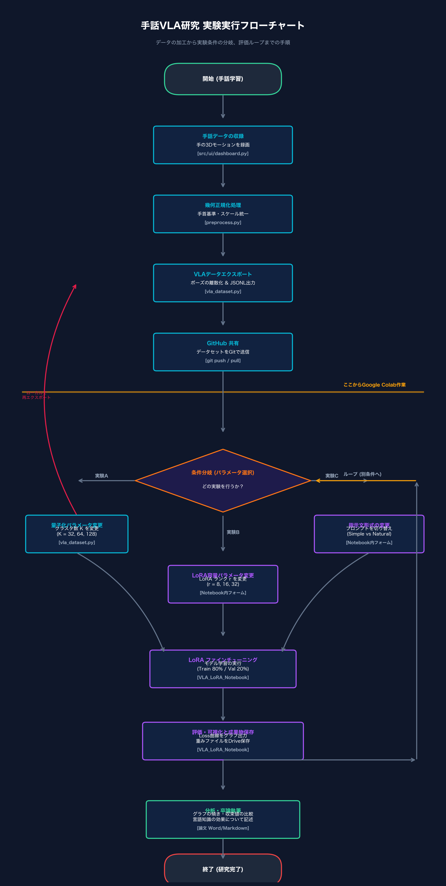
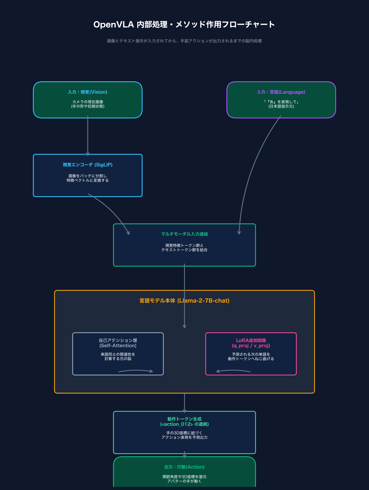

# 手話VLAシステム：全体データフローおよびモデル動作機構

本ドキュメントでは、手話動作データの収集・前処理からVLA（Vision-Language-Action）モデルのファインチューニング、および生成された動作の復元・制御に至る全体フローと内部メカニズムを定義する。

---

## 1. 全体データフローマップ



---

## 2. OpenVLAの内部処理機構

画像およびテキスト指示が入力されてから、手話アクションが出力されるまでのモデル内部のデータフローは以下の通りである。



### 処理ステップ
1. **マルチモーダル入力 (Vision & Language)**:
   - 視覚入力（画像）および自然言語入力（指示文）を同時に受け取る。
2. **視覚特徴抽出 (SigLIP)**:
   - 視覚エンコーダ（SigLIP）により、入力画像からパッチ単位の視覚埋め込みベクトル列を抽出する。
3. **入力系列の結合**:
   - 抽出された画像トークン系列と言語トークン系列を結合し、Transformerへの入力系列とする：`[画像トークン] + [指示文トークン]`
4. **言語モデル（LLM）とLoRAアダプタの作用**:
   - 言語モデル（Llama-2-7B）の自己アテンション層（Self-Attention）にLoRAアダプタを適用し、出力分布がポーズトークン（例: `<pose_24>`）を生成するよう誘導する。
5. **アクション出力と復元**:
   - 生成された離散トークン系列を、K-Meansコードブックを用いて3D骨格座標およびサーボ制御コマンドへと逆変換する。

---

## 3. LoRA（Low-Rank Adaptation）によるパラメータ効率的学習

本研究では、大規模モデル（OpenVLA-7B）の全パラメータを更新するのではなく、パラメータ効率的ファインチューニング（PEFT）手法である **LoRA** を採用する。

- **手法の概要**:
  - 事前学習済みの基底モデル（約70億パラメータ）の重み行列 $W$ は固定（フリーズ）する。
  - 自己アテンション層の重み更新量を低ランク行列の積 $\Delta W = B \cdot A$ （ここで $A \in \mathbb{R}^{r \times d}, B \in \mathbb{R}^{d \times r}, r \ll d$）としてモデル化し、行列 $A, B$ のみを最適化する。
- **利点**:
  - 学習対象パラメータ数が全体の0.1%以下に削減され、GPUメモリ消費量および計算時間を大幅に低減する。
  - 少数サンプル（Few-shot）条件下での過学習を抑制し、安定した収束を実現する。

---

## 4. 比較実験の設計と検証項目

本研究における3つの主要な比較実験の設計および評価観点は以下の通りである。

### 【実験A】コードブックサイズ（クラスタ数 $K$）の影響評価
手の3D関節座標（126次元）を離散トークン化する際のクラスタ数 $K$ の影響を検証する。
- **設定値**: $K = 32$（粗い表現） vs $K = 64$（基準値） vs $K = 128$（細かい表現）
- **評価観点**:
  - クラスタ数 $K$ に対するポーズ再構成誤差（MSE）と、VLAモデルの言語モデリング損失（Loss）のトレードオフを測定し、最適な語彙サイズを特定する。

### 【実験B】LoRAランク $r$ による表現力と過学習耐性の比較
LoRAアダプタのランク値 $r$ を変化させ、少数データに対するモデルの表現力と汎化性能を検証する。
- **設定値**: $r = 8$（低容量） vs $r = 16$（基準値） vs $r = 32$（高容量）
- **評価観点**:
  - 訓練損失（Train Loss）の収束速度と、未知の検証セットに対する汎化損失（Validation Loss）を比較し、Few-shot学習に最適なランク値を決定する。

### 【実験C】プロンプト形式による言語知識転移効果の比較
指示文プロンプトの記述形式が動作獲得効率に与える影響を評価する。
- **設定値**:
  - 単純ID形式: `Instruction: ClassID_01`
  - 日本語指示文形式: `Instruction: ひらがなの「あ」を手話で表現してください`
- **評価観点**:
  - 大規模言語モデルが事前学習で獲得した自然言語の語彙的知識・文脈情報が、身体動作トークンの生成予測に寄与するかを比較する。

---

## 5. 内部モジュールと実験パラメータの対応関係

```text
[入力: 画像 + テキスト] ──> [視覚エンコーダ] ──> [言語モデル (Llama-2)] ──> [動作トークン系列]
                                                      │                        │
       実験C (プロンプト形式)                           │                        │  実験A (クラスタ数 K)
       ・言語知識の転移効果を検証                       │                        │  ・動作トークンの語彙数を決定
                                                      ▼                        ▼
                                              LoRAアダプタ (実験B)        動作復元・制御
                                              ・ランク r の最適化         (hand_viewer / bridge_vla)
```
